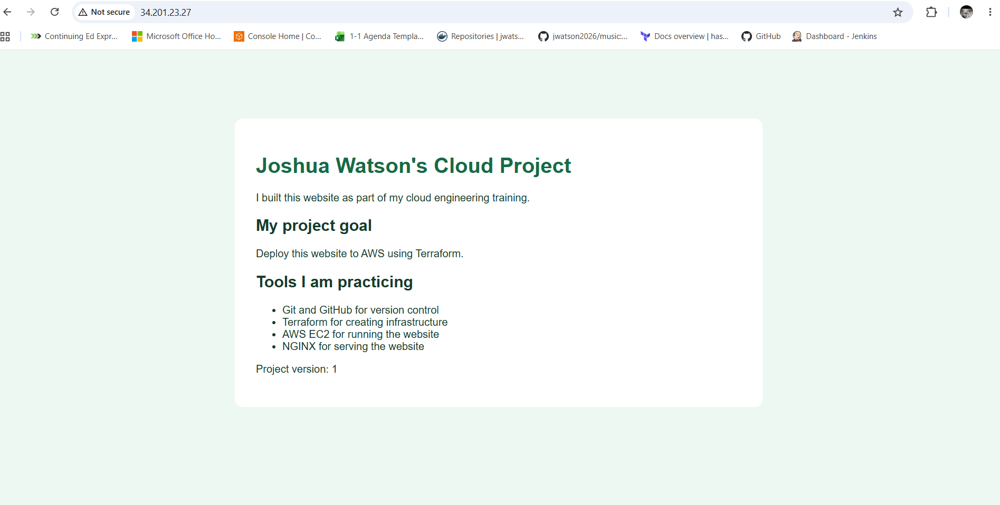

# Joshua Watson's Cloud Website Project

## Overview
Built a website and deployed it to AWS using Terraform.

## Completed
- Created a website using HTML and CSS.
- Verified the website locally in a browser.
- Saved the project using Git and uploaded it to GitHub.
- Used an existing VPC and public subnet in us-east-1.
- Created an Ubuntu EC2 instance using Terraform.
- Created a security group allowing HTTP traffic on port 80.
- Automated NGINX installation and website publishing with a startup script.
- Verified the deployed website using its public HTTP address.

## Tools used
- HTML and CSS
- Git and GitHub
- Terraform
- AWS CLI and EC2
- Ubuntu Linux
- NGINX
- VS Code

## Project files
- index.html: Website content and styling.
- main.tf: AWS provider configuration.
- network.tf: References to the existing VPC and subnet.
- security.tf: Website firewall rules.
- server.tf: Ubuntu image lookup, EC2 configuration, and website URL.
- user-data.sh: Installs NGINX and publishes the website.
- .gitignore: Excludes local Terraform state and private files.
- .terraform.lock.hcl: Records provider dependency selections.

## Troubleshooting
The initial Ubuntu image lookup failed because my AWS user
lacked ssm:GetParameter permission.

I updated Terraform to find an official Canonical Ubuntu
image through EC2 instead. The deployment then succeeded.

## View the deployed website
Run this command from the project folder:

terraform output -raw website_url

Open the returned HTTP address in a browser while the server is running.

## Current limitations
- One server; no high availability.
- HTTP only; HTTPS is not configured.
- Deployment is started manually using Terraform.

## Cleanup
Review removal with:
terraform plan -destroy

Remove the resources managed by this project with:
terraform destroy

The existing VPC and subnet are referenced, not managed,
so Terraform will not delete them.

## Status
AWS deployment completed and verified in a browser.

## Deployment screenshot

